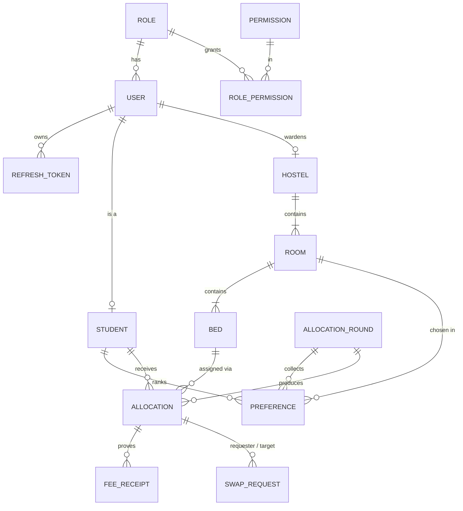

# Hostel Room Allocation System

A RESTful hostel allocation service (Node.js + Express) with a React client.
Built for CSA504 Full Stack Development. Every syllabus module maps to something concrete in the code (see the table at the end).

**Allocation happens in two rounds:**

1. **Round 1, priority allocation.** Students rank up to five rooms. The admin runs a batch job that orders students by *PwD → year (seniority) → CGPA* and gives each one their highest-ranked room with a free bed. If all their chosen rooms are full, they get any free bed in the hostel of their first choice.
2. **Round 2, open booking.** Students left without a bed book first-come-first-served. **Fifty students hitting the last bed at the same instant produce exactly one `201` and forty-nine `409`s.**

```
hostel-allocation/
├── server/   Express API · PostgreSQL (Sequelize) · MongoDB (Mongoose)
└── client/   React (Vite) · React Router · Axios · Tailwind
```

---

## Quick start (local)

**Prerequisites:** Node 20+, PostgreSQL 14+, and optionally MongoDB 6+. MongoDB is only used for audit logs and notifications; the API runs without it.

```bash
# 1. API
cd server
cp .env.example .env            # then edit DATABASE_URL and the two JWT secrets
createdb hostel                 # or create it in pgAdmin
npm install
npm run db:setup                # applies db/migrations/*.sql, then seeds data
npm run dev                     # http://localhost:4000  ·  Swagger UI at /api/docs

# 2. Client (new terminal)
cd client
cp .env.example .env            # VITE_API_URL=http://localhost:4000/api/v1
npm install
npm run dev                     # http://localhost:5173
```

On a Mac with Homebrew: `brew install postgresql@16 mongodb-community && brew services start postgresql@16 && brew services start mongodb-community`.

**Or with Docker** (PostgreSQL + MongoDB + API together):

```bash
cd server
docker compose up --build
docker compose exec api npm run seed
```

### Demo accounts (created by the seed)

| Role | Email | Password | Notes |
|---|---|---|---|
| Admin | `admin@hostel.edu` | `Admin@123` | All hostels |
| Warden | `warden1@hostel.edu` … `warden10@hostel.edu` | `Warden@123` | warden*N* manages hostel *N* (warden2 = Bhaskara Hall) |
| Student | `s00001@hostel.edu` | `Student@123` | HR00001 Aarav Sharma, male, year 2, no preferences yet |
| Student | `s00002@hostel.edu` | `Student@123` | HR00002 Rohan Das, male, year 2, already has preferences |
| Student | `s00003@hostel.edu` | `Student@123` | HR00003 Ananya Iyer, female, year 1 |

All 5,000 seeded students use `s00001` … `s05000` with the same password.

**Seed volume** (so indexes visibly matter): 10 hostels · 1,500 rooms · ~3,800 beds · 5,000 students · 4 past sessions (~12,000 historical allocations) · current round 2026-27 in `PREFERENCES_OPEN` with ~11,000 preferences.

---

## ER diagram



The full column-level schema is in [`server/db/migrations/001_init.sql`](server/db/migrations/001_init.sql).

**Key modelling decisions**

- **The unit allocated is a bed, not a room.** A 3-seater room has beds A, B and C. This makes "last bed in the room" a single row that can be locked.
- **Allocations are never deleted or overwritten.** A swap marks the two old rows `SWAPPED` and inserts two new ones, so the full history of who slept where is preserved.
- **"One bed per student" and "one student per bed" are enforced by the database**, through partial unique indexes over *active* statuses only:
  ```sql
  CREATE UNIQUE INDEX uq_alloc_active_bed ON allocations(session, bed_id)
    WHERE status IN ('ALLOCATED','FEE_SUBMITTED','VERIFIED','CHECKED_IN');
  ```
  These are partial because a bed vacated last year must be allocatable again this year.

---

## Architectural decision: PostgreSQL vs MongoDB

> **Core entities are in PostgreSQL because they need transactional integrity and referential constraints. Audit logs and notifications are in MongoDB because they are append-only, schema-flexible and high-volume, and they never participate in a transaction.**

| PostgreSQL | MongoDB |
|---|---|
| users, roles, permissions | `audit_logs`: one immutable document per state change |
| hostels, rooms, beds | `notifications` |
| rounds, preferences, allocations, swaps, receipts | |

**Trade-off:** an audit entry is written *after* the SQL transaction commits. If MongoDB is down, the business operation still succeeds and the missing log entry is reported in the server log. The alternative (outbox table + worker) guarantees delivery but adds a moving part that no syllabus module asks for. Audit writes are deliberately best-effort.

### Second decision: token storage

The **access token** (15 min) lives in JavaScript memory only. The **refresh token** (7 days) is an `httpOnly`, `SameSite` cookie scoped to `/api/v1/auth`.

- **Why not localStorage?** Any injected script can read localStorage (XSS). An httpOnly cookie is invisible to JavaScript.
- **Cost:** cookies bring CSRF considerations and need `credentials: true` in CORS. The cookie is only sent to `/api/v1/auth/*`, and refresh only *returns* a token to an allow-listed origin, so a forged cross-site request gains nothing.
- **Rotation + reuse detection:** every refresh token is single-use. Presenting a token that was already used revokes *all* that user's sessions, so a stolen old token stops working everywhere.

---

## The hard parts (viva talking points)

### 1. Last-bed booking ([`server/src/services/allocation.js`](server/src/services/allocation.js) → `bookBed`)

```sql
SELECT b.id FROM beds b
 WHERE b.room_id = :roomId
   AND NOT EXISTS (SELECT 1 FROM allocations a
                    WHERE a.bed_id = b.id AND a.session = :session AND a.status IN (...active))
 ORDER BY b.label LIMIT 1
 FOR UPDATE OF b SKIP LOCKED
```

- The bed row is locked **inside a transaction**. `SKIP LOCKED` means a concurrent request that already locked bed A moves on to bed B instead of waiting.
- **Second line of defence:** if two transactions still race (one commits between the other's snapshot and its lock), the partial unique index rejects the second insert, and it is turned into a clean `409`.
- The round row is read `FOR SHARE`, so an admin closing booking (`FOR UPDATE`) waits for in-flight bookings to finish.

**Prove it:** `npm run demo:concurrency` (with the API running and booking open):

```
Room 424 in Aryabhata Hall now has exactly 1 free bed.
Firing 50 simultaneous POST /rounds/5/book requests...

HTTP status counts: { '201': 1, '409': 49 }
Winner: HR00009 -> bed A
Sample 409 message: "No free bed left in room 424"
DB check: room occupancy 1/1, racers holding a bed: 1
RESULT: PASS: exactly one booking succeeded, no double allocation.
```

### 2. Atomic room swap (`approveSwap`)

Both students move in **one transaction**, or neither does. The two allocation rows are locked in **ascending id order**. Two wardens approving overlapping swaps in opposite order would otherwise deadlock; a fixed lock order makes a deadlock impossible.

### 3. Lifecycle as data

```js
const TRANSITIONS = {
  ALLOCATED:     { FEE_SUBMITTED: 'receipt:upload', RELEASED: 'allocation:release' },
  FEE_SUBMITTED: { VERIFIED: 'receipt:verify', ALLOCATED: 'receipt:verify' },  // reject → re-upload
  VERIFIED:      { CHECKED_IN: 'allocation:update' },
  CHECKED_IN:    { VACATED: 'allocation:update' },
};
```

The table says both *which* moves are legal and *which permission* each one needs. Invalid moves return `409` and list `allowedNext`. A cron job (`node-cron`, hourly) releases `ALLOCATED` rows whose fee deadline has passed, using a single atomic `UPDATE … RETURNING`.

### 4. Contextual authorisation

RBAC checks **permissions** (`receipt:verify`), never role names. On top of that, a warden may act **only on their own hostel**: warden 1 holds `receipt:verify` but still gets `403` on a Bhaskara Hall allocation. Admins hold `hostel:all`, which bypasses the scope check. Approving a cross-hostel swap requires authority over **both** hostels.

---

## Viva demo script (≈ 3 minutes)

1. **The 403 demo.** Log in as `s00001` in the browser and point out there is no "Verify fee" button. Copy the access token from DevTools → Network → any request's `Authorization` header. In Postman, call `PATCH /allocations/1/status` with `{"status":"VERIFIED"}` using that token → **403**. *"The interface hid the button; the server is what refused."*
2. **Token refresh.** Leave the page for 15+ minutes (or start the API with `ACCESS_TOKEN_TTL=20s`) and click any tab. The Network tab shows the 401, **one** `/auth/refresh`, then the retried requests.
3. **Concurrency.** As admin: Rounds → *Run allocation* → *Open booking*. Then run `npm run demo:concurrency` and show the 1 × 201 / 49 × 409 output. Optional live version: two browser windows as two eligible students, same last bed, click together.
4. **Indexes.** `npm run demo:explain` prints each key query's plan with and without its index (Seq Scan + Sort → Index Scan).
5. **Swagger.** Open `/api/docs`.

---

## Scripts (server)

| Command | What it does |
|---|---|
| `npm run dev` / `npm start` | Start the API (nodemon / node) |
| `npm run migrate` | Apply pending SQL files from `db/migrations/` |
| `npm run seed` | **Wipe** and reseed all tables |
| `npm run db:setup` | Migrate + seed |
| `npm run demo:concurrency [-- N]` | Last-bed race with N simultaneous requests (default 50) |
| `npm run demo:explain` | EXPLAIN ANALYZE before/after for four indexes |
| `node scripts/e2e-check.js` | 40+ HTTP checks across the whole cycle (run on a fresh seed) |

---

## API overview

Base path `/api/v1`. Full OpenAPI spec at **`/api/docs`** (raw JSON at `/api/openapi.json`). Postman collection: [`server/docs/postman_collection.json`](server/docs/postman_collection.json).

| Area | Endpoints |
|---|---|
| Auth | `POST /auth/login` · `POST /auth/refresh` · `POST /auth/logout` · `GET /auth/me` |
| Hostels | `GET /hostels` · `GET /hostels/:id/rooms?floor=&available=&sort=&page=&limit=` |
| Rounds | `GET /rounds` · `GET /rounds/current` · `POST /rounds` · `PATCH /rounds/:id/status` · `GET\|PUT /rounds/:id/preferences` · `POST /rounds/:id/run` · `POST /rounds/:id/book` |
| Allocations | `GET /allocations/me` · `GET /allocations?status=&hostelId=&q=&sort=&page=` · `GET /allocations/:id` · `PATCH /allocations/:id/status` · `POST\|GET /allocations/:id/receipt` |
| Swaps | `GET /swaps` · `POST /swaps` · `PATCH /swaps/:id/respond` · `PATCH /swaps/:id/cancel` · `PATCH /swaps/:id/decision` |
| Reports / Admin | `GET /reports/occupancy` · `POST /admin/jobs/release-unpaid` · `GET /admin/audit-logs` · `GET /notifications/me` |

**Status codes used deliberately:** `201` + `Location` on creation · `204` on logout · `401` missing/expired token vs `403` lacking permission or hostel scope · `409` conflicts (no free bed, invalid transition, duplicate swap) · `413` file too large · `415` wrong file type or content · `422` validation failures · `429` login rate limit.

**One error shape everywhere:**

```json
{ "error": { "code": "CONFLICT", "message": "No free bed left in room 424", "requestId": "5c0e…" } }
```

---

## Deployment

The live setup is **one Render web service** that runs the API *and* serves the built React client, plus **Neon** for PostgreSQL. Everything is defined in [`render.yaml`](render.yaml).

- **Same origin.** The client calls `/api/v1` on its own domain, so there is no CORS and no cross-site cookie between two domains.
- **Database setup on first boot.** `npm run start:prod` applies pending migrations, seeds demo data only if the database is empty, then starts the API. Restarts and redeploys keep your data.
- **Secrets.** `JWT_*_SECRET` are generated by Render. `DATABASE_URL` (Neon) and `MONGO_URI` (optional, MongoDB Atlas) are entered at deploy time and never committed.
- **Free-tier behaviour.** The service sleeps after 15 minutes idle, and the next visit wakes it in about a minute. Neon's free compute also auto-suspends and resumes in about a second.

> Uploaded receipts are stored on the service's local disk, which Render's free tier wipes on redeploy. Fine for a demo; production would use object storage (S3/Cloudinary).

**Running the client separately** (for example on Netlify) also works: build with `VITE_API_URL=https://<api>/api/v1` and add the client's origin to `CORS_ORIGINS`. `public/_redirects` and `vercel.json` handle SPA routing there.

---

## Syllabus coverage

| Module | Where |
|---|---|
| **1–2 REST** | `/api/v1` versioning · PATCH vs PUT (`PUT` replaces the whole preference list, `PATCH` changes one status) · zod validation on every endpoint (`middleware/validate.js`) · centralised error handler · custom middleware: `requestId`, `authenticate`, `requirePermission`, `verifyMagicBytes` · Postman collection |
| **3 Databases** | Normalised schema + ER diagram · Sequelize (SQL) + Mongoose (MongoDB) · 13 indexes, each justified by a comment in `001_init.sql` · `npm run demo:explain` · transactions in booking, Round 1, swaps, receipt upload, refresh rotation · seed of 5,000 students |
| **4 Security** | JWT access + refresh with rotation and reuse detection · bcrypt (12 rounds in production) · permission-driven RBAC + hostel scope · multer with MIME, size **and** magic-byte checks · pino logs with request IDs · env config validated at boot · helmet, CORS allow-list, rate limiting on auth |
| **5 Docs & deploy** | Swagger UI at `/api/docs` · Dockerfile + docker-compose · this README |
| **Frontend** | Vite + React · single-flight refresh interceptor (`client/src/api/client.js`) · permission-driven navigation · paginated/filtered/sorted lists mapped to query params · upload with progress bar · loading/error/empty states on every view |
